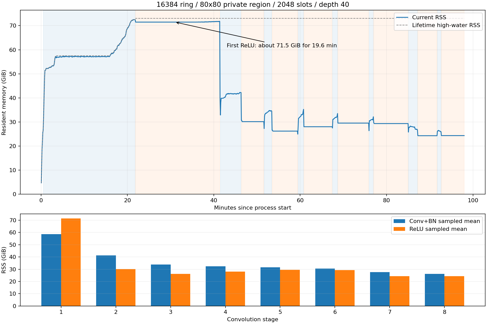

# 实验完成后的内存监控结论

实验于北京时间 2026-10-24 02:29 完成，16/16 项均完成，无内存回退。本文重点分析最后一项：ringDim=16384、80×80、2048 slots、30/40、digits=6、depth=40、全局 96 线程、直接旋转、无并发限制、8 层卷积。

## 统计范围

5 秒间隔读取进程当前 RSS；最后一项获取了 1171 个模型进程样本，覆盖约 97.88 分钟，进程总耗时约 98.04 分钟。已排除启动瞬间误采的一条 GNU time 包装进程记录。阶段从已刷新日志推断，切换定位精度约一个采样间隔。

这些是同进程实验的 RSS：客户端准备、明文参考对象和分配器保留页未被完全隔离。它不是独立云服务进程的严格内存测量。5 秒采样最大值和内核历史高水位不是同一指标。

## 主要结果

- 全观察窗口时间加权平均 RSS：44.06 GiB。
- 中位数：31.93 GiB；P95：71.52 GiB。
- 采样最大值：72.52 GiB；进程历史峰值：73.05 GiB。
- RSS 超过 60 GiB 约 24.1 分钟，超过 70 GiB 约 21.0 分钟。阈值持续时间按相邻样本区间近似，不能视为连续精确测量。

密钥准备阶段采到的最大 RSS 约 18.6 GiB，输入加密/第一层准备阶段约 26.5 GiB。随后第一层卷积逐步升到 72.5 GiB；卷积至 ReLU 的切换附近，内核历史高水位升到 73.05 GiB。高内存不是只有密钥生成时出现，也不是持续几秒的尖峰。

## 逐层数据

| 层 | Conv+BN 时间 分钟 | Conv 采样均值 GiB | Conv 采样最大 GiB | ReLU 时间 分钟 | ReLU 采样均值 GiB | ReLU 采样最大 GiB |
|---:|---:|---:|---:|---:|---:|---:|
| 1 | 21.50 | 58.57 | 72.52 | 19.56 | 71.52 | 71.83 |
| 2 | 4.87 | 41.17 | 42.25 | 5.25 | 30.17 | 30.69 |
| 3 | 1.84 | 33.79 | 34.78 | 5.98 | 26.21 | 26.60 |
| 4 | 1.36 | 32.47 | 35.27 | 6.59 | 28.04 | 28.05 |
| 5 | 1.23 | 31.55 | 33.53 | 7.24 | 29.55 | 29.55 |
| 6 | 1.12 | 30.61 | 32.17 | 8.01 | 29.35 | 29.78 |
| 7 | 2.12 | 27.60 | 28.30 | 4.56 | 24.31 | 24.33 |
| 8 | 0.90 | 26.24 | 26.54 | 5.37 | 24.36 | 24.36 |

## 已确认的规律与原因边界

1. 第一层卷积的 RSS 均值约 58.6 GiB，且第一层 ReLU 在约 71.5 GiB 平台持续约 19.6 分钟。此前将高值称为短时尖峰不准确。
2. 第一层 ReLU 结束后，样本降至约 39.1 GiB；第二层 ReLU 约 30.2 GiB；后续 ReLU 多为 24–30 GiB。你看到的约 28 GiB 主要反映后续阶段，不能代表全程平均。
3. 第一层同时处理 64 个输出通道、43 个受影响输出行。以一个高层级密文约 10.25 MiB 粗算，仅通道累加器的容量量级就可达 64×43×10.25 MiB≈27.5 GiB，此外还有输入旋转缓存、输出、密钥和密钥切换临时工作区。该估算解释峰值来源量级，不是分项实测。
4. 第一层 ReLU 期间的 smaps 显示，约 67.9 GiB 集中在 1122 个接近 64 MiB 的匿名可写映射中，与多线程 glibc 堆分配区形态相符。结合卷积局部缓存生命周期，分配器保留/碎片是合理怀疑；但是没有读取分配器已用/空闲统计，不能确认其中多少空间已经空闲，也不能排除仍存活的转换对象。
5. 没有执行 malloc_trim、调试器注入、减少线程或更换算法来干预本轮测量。进程结束后，整机已用内存回到约 2 GiB。退出后释放并不证明运行期没有泄漏。

## 内存曲线

蓝线为当前 RSS；虚线是从进程启动累计的历史高水位，不能理解为各层的当前用量。下图比较各层 Conv/ReLU 的采样均值。

[原始 RSS](rss_samples.csv) · [阶段采样](rss_stage_samples.csv) · [完整实验表](REPORT.md) · [内存统计口径](MEMORY_ACCOUNTING.md)
